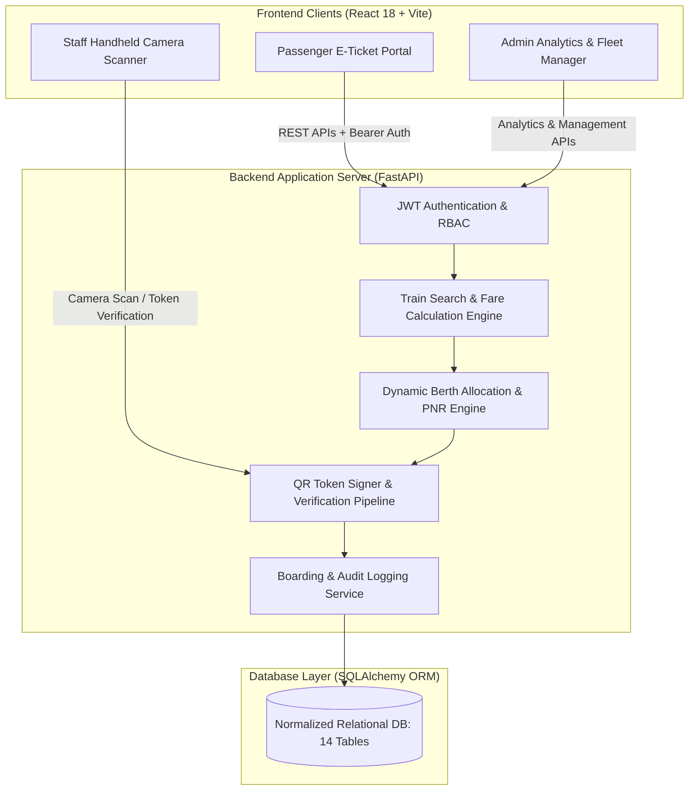

# Smart Rail QR – Intelligent Railway Ticket Verification & Passenger Management System

> **A Next-Generation Digital Transit Identity, Real-Time Cryptographic Verification, and On-Board Passenger Management Platform.**

---

## 🚄 1. Project Overview & Core Innovation

Smart Rail QR transcends conventional railway reservation systems by converting booked railway tickets into **tamper-proof, cryptographically signed digital QR identities**. 

Rather than storing vulnerable raw passenger PII inside the QR code, the system generates **HMAC-SHA256 authenticated high-entropy tokens** mapped directly to the central railway database.

### 🌟 Key Innovations:
1. **Cryptographic QR Tokenization**: Server-side signed tokens with instant forgery detection and zero raw personal data leakage.
2. **Real-Time Duplicate Scan Detection**: Tracks scan counts, first scan timestamps, inspector badges, station checkpoints, and device signatures. Flags unusual or duplicate scan frequency without falsely rejecting legitimate re-inspections.
3. **Live Boarding Lifecycle Management**: One-click status transitions (`NOT_VERIFIED` $\rightarrow$ `VERIFIED` $\rightarrow$ `BOARDED` / `NO_SHOW`).
4. **Digital Train Passenger Manifest**: Real-time coach-by-coach seating charts for TTEs with instant search, occupancy heatmaps, and vacant seat tracking.
5. **Executive Operations & Fraud Analytics**: Central administration dashboard with live KPI counters, revenue analytics, real-time audit ledger, and CSV export.

---

## 🏗️ 2. System Architecture



---

## 🗄️ 3. Normalized Relational Database Design

The system implements 14 normalized relational tables with full foreign keys, cascading rules, and indexes:

| Table | Description |
|---|---|
| `users` | User accounts with roles (`passenger`, `staff`, `admin`), password hashes, and profiles |
| `staff_profiles` | TTE & Inspector details, badge numbers, designations, and assigned trains/stations |
| `stations` | Station codes (e.g. `NDLS`, `CSMT`, `HWH`, `BPL`), zones, and platform counts |
| `trains` | Trains (e.g. `12002 Bhopal Shatabdi`, `22436 Vande Bharat`), types, and operating days |
| `schedules` | Stop sequences, arrival/departure timestamps, platform numbers, and distance offsets |
| `coaches` | Train coaches (`EC1`, `C1`, `C2`, `B1`, `A1`, `H1`) and capacities |
| `berths` | Individual berth records, numbering, and types (Lower, Middle, Upper, Window, Aisle) |
| `fare_rules` | Distance-based fare rules, reservation fees, superfast charges, and GST rates |
| `reservations` | Booking records with 10-digit PNR (`842-9182301`), journey date, class, and payment status |
| `passengers` | Individual passenger details, age, gender, berth preferences, and ID proof data |
| `tickets` | Digital ticket records with HMAC security signatures |
| `qr_tokens` | High-entropy signed tokens (`SRQR-XXX...`), expiration timestamps, and revocation flags |
| `verification_records` | Verification scan logs with scan counts, staff badge, station, device, and result |
| `boarding_records` | Real-time passenger boarding status (`NOT_VERIFIED`, `VERIFIED`, `BOARDED`, `NO_SHOW`) |

---

## 👥 4. System Roles & Demo Credentials

| Role | Email | Password | Badge / Details |
|---|---|---|---|
| **Passenger** | `kishore@example.com` | `Passenger@123` | Active booking on Bhopal Shatabdi (`C2/36`) |
| **Passenger** | `deepika@example.com` | `Passenger@123` | Active booking on Vande Bharat (`EC1/18`) |
| **Railway TTE** | `tte@smartrail.in` | `Staff@123` | Badge: `TTE-NDLS-901` (Assigned to Train 12002) |
| **Gate Inspector** | `inspector@smartrail.in` | `Staff@123` | Badge: `GATE-CSMT-402` (Assigned to CSMT Gate) |
| **Admin Controller** | `admin@smartrail.in` | `Admin@123` | Full Operations & Fleet Analytics Access |

---

## 🚀 5. Quick Start & Execution

### Prerequisites
- Python 3.10+
- Node.js 18+ and npm

### Option A: One-Click Launch (Windows)
Double-click `scripts/run_all.bat` or run:
```bash
.\scripts\run_all.bat
```

### Option B: Manual Startup

#### 1. Backend API Server
```bash
cd backend
pip install -r requirements.txt
python run.py
```
- API Server runs at: `http://localhost:8000`
- Interactive Swagger UI Documentation: `http://localhost:8000/docs`

#### 2. React Frontend Portal
```bash
cd frontend
npm install
npm run dev
```
- Frontend Web Application runs at: `http://localhost:5173`

---

## 🧪 6. Automated Pytest Test Suite

Execute the backend test suite covering authentication, train search, reservation generation, and multi-stage verification with duplicate scan detection:

```bash
cd backend
python -m pytest -v
```

All 12 automated test cases validate:
- User registration & JWT authentication
- Role-based access control (Passenger vs Staff vs Admin)
- Station lookups and multi-train search with live fare calculation
- PNR and coach/berth auto-allocation
- Cryptographic QR token generation & base64 rendering
- Valid ticket verification $\rightarrow$ status `VALID`
- Re-scan duplicate detection $\rightarrow$ status `DUPLICATE_SCAN` with scan counts
- Counterfeit / unverified QR token rejection $\rightarrow$ status `INVALID_TOKEN`
- Cancelled ticket verification rejection $\rightarrow$ status `CANCELLED`
- Staff boarding lifecycle transitions (`NOT_VERIFIED` $\rightarrow$ `VERIFIED` $\rightarrow$ `BOARDED`)

---

## 🔒 7. Security Architecture

1. **Tamper-Proof HMAC Signatures**: Every ticket and QR payload is signed using server-side HMAC-SHA256 secret keys. Any altered payload is rejected immediately.
2. **Database-Validated Verification**: QR scans are never trusted client-side. The backend verifies the token status, ticket revocation state, and expiration timestamps.
3. **Audit Ledger**: Every scan attempt (including failed and duplicate attempts) is immutably logged with client device fingerprints, staff IDs, and timestamps.
